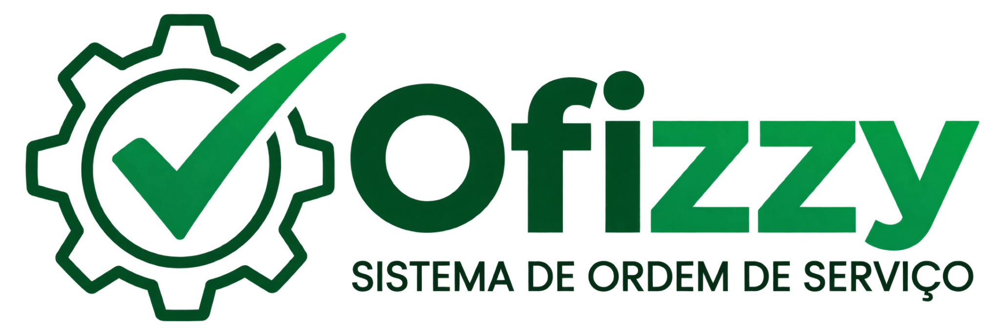
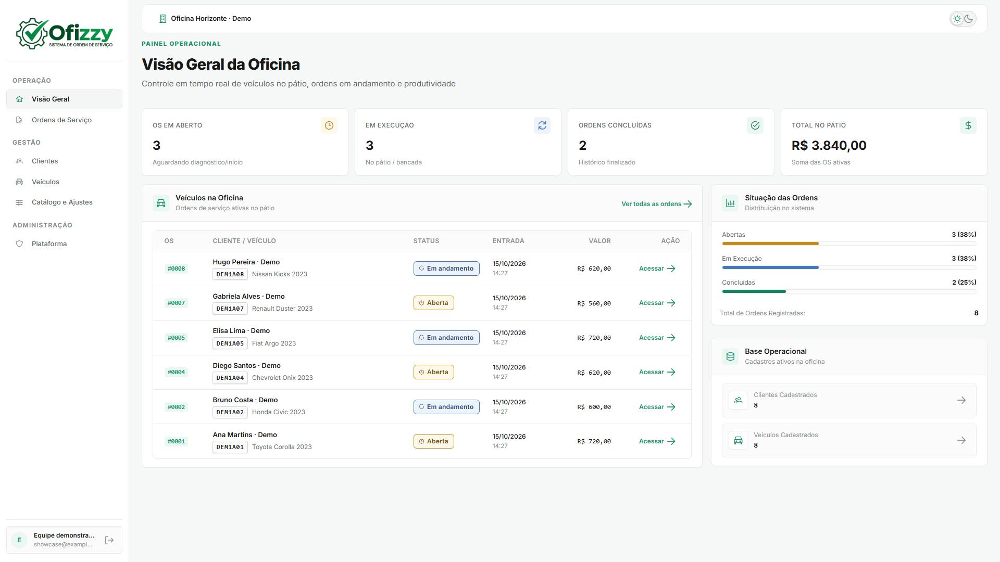
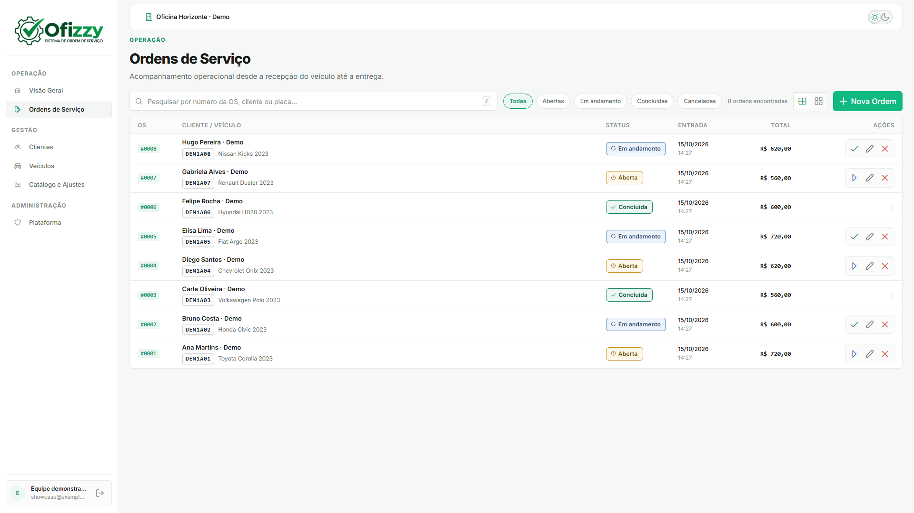
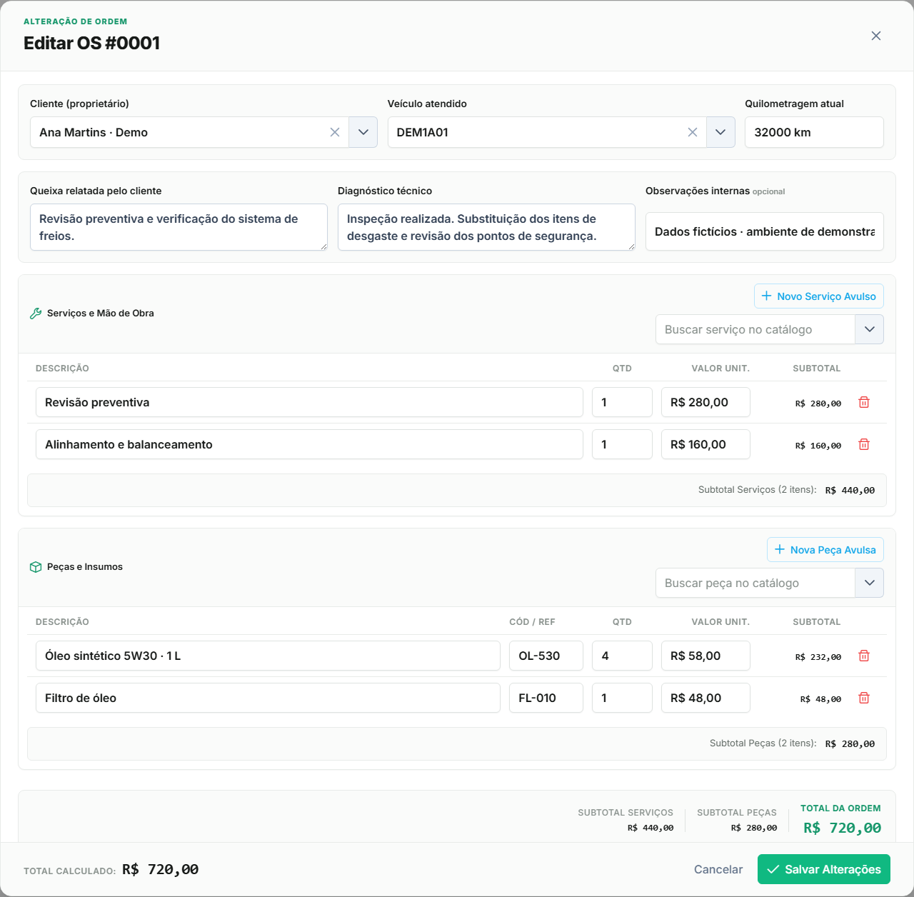
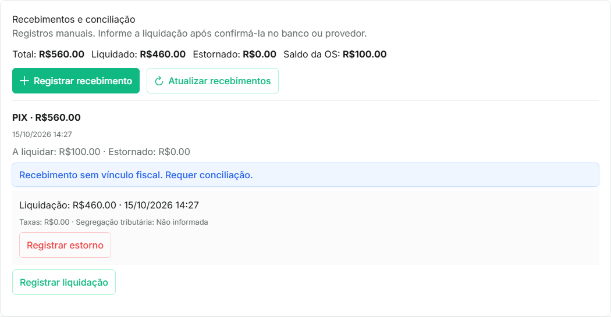
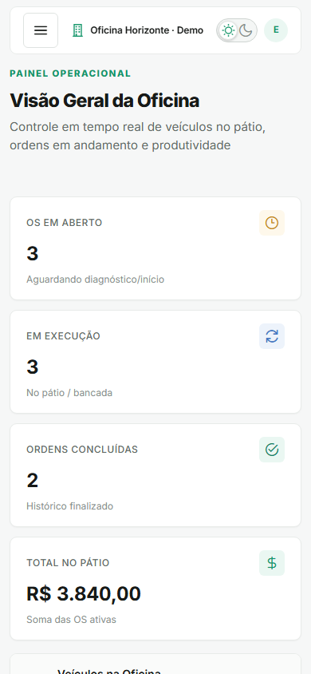
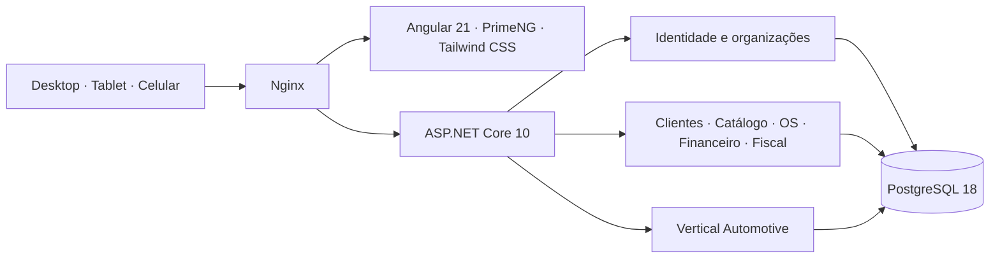

<div align="center">
  <picture>
    <source media="(prefers-color-scheme: dark)" srcset="docs/assets/logo-dark.png">
    <source media="(prefers-color-scheme: light)" srcset="docs/assets/logo.png">
    
  </picture>

  <h1>Uma operação organizada.<br>Do primeiro atendimento à entrega.</h1>

  <p>Gestão para empresas prestadoras de serviços.<br>Clientes, veículos, ordens de serviço e recebimentos em uma plataforma SaaS multi-tenant.</p>

  <p>
    <a href="https://github.com/Pedroltz/ofizzy/actions/workflows/pull-request.yml"></a>
    
    
    
  </p>

  <p>
    <a href="#o-produto-em-ação">Conheça o produto</a> ·
    <a href="#comece-por-aqui">Executar localmente</a> ·
    <a href="#documentação">Documentação</a> ·
    <a href="docs/NEXT-STEPS.md">Próximos passos</a>
  </p>
</div>

<br>



## Gestão conectada, da recepção ao financeiro

O **Ofizzy** reúne a rotina operacional de prestadores de serviços em um único lugar. A primeira vertical é **Automotive**, com um fluxo que conecta cliente, veículo, diagnóstico, serviços, peças e entrega.

Cada organização tem seus usuários, permissões, módulos e dados. Uma nova empresa é provisionada pela própria plataforma, sem outro deploy ou banco dedicado.

| Recurso | O que você pode fazer |
| --- | --- |
| **Clientes e veículos** | Pesquisar cadastros, consultar contatos e manter o vínculo entre cliente e veículo. |
| **Catálogo** | Organizar serviços e peças com preços e classificação fiscal por vigência. |
| **Ordens de serviço** | Registrar queixa e diagnóstico, incluir itens e acompanhar o atendimento até a conclusão. |
| **Recebimentos** | Registrar pagamentos, liquidações parciais, taxas e estornos com histórico na OS. |
| **Dashboard e documentos** | Acompanhar indicadores operacionais e imprimir ordens de serviço em HTML/PDF. |
| **Organizações e acesso** | Provisionar empresas, concluir onboarding e trabalhar com múltiplos vínculos e papéis. |
| **Desktop, tablet e celular** | Operar com layouts adaptados, incluindo cartões e controles próprios para toque. |

## O produto em ação

Capturas da aplicação com API real e PostgreSQL, usando apenas dados fictícios em ambiente isolado. [Como atualizar as imagens](docs/assets/README.md).

### Acompanhe cada atendimento



### Todos os detalhes da OS, no mesmo fluxo



### Recebimentos com histórico



<div align="center">
  <h3>A operação também cabe no celular</h3>
  
</div>

## Estado do projeto

O produto está em desenvolvimento ativo. Os fluxos operacionais e o financeiro manual estão implementados; o módulo fiscal tem implementação local avançada e **ainda depende de homologação externa**.

Configuração e preparação fiscal, assinatura e validação de XML, consultas, cancelamentos e documentos auxiliares fazem parte da fase atual. A transmissão/PDF RTC e a cadeia fiscal alfanumérica completa permanecem pendentes. Testes locais e simulação não equivalem à autorização de SEFAZ ou NFS-e Nacional. O financeiro manual não executa Split Payment automático.

Consulte o [status com evidências](docs/STATUS.md), a [fase fiscal](docs/phases/PHASE-08-FISCAL.md) e os [critérios dos próximos passos](docs/NEXT-STEPS.md).

## Arquitetura

Um **monólito modular**: uma API ASP.NET Core, um frontend Angular e um PostgreSQL compartilhado. O backend concentra autorização, isolamento por organização, regras de negócio e cálculos; o Nginx entrega uma origem única.



Decisões e limites estão em [Arquitetura](docs/ARCHITECTURE.md), [Modelo de dados](docs/DATA-MODEL.md) e [ADRs](docs/adr/).

## Comece por aqui

**Pré-requisito:** Docker com Compose. Na raiz do repositório:

```bash
cp .env.example .env
# Edite .env: configure senhas e uma chave JWT aleatória de pelo menos 32 bytes.
docker compose build
docker compose --profile tools run --rm migrate
docker compose up -d --wait
```

A origem padrão é `http://localhost:8080`. Em banco vazio, habilite temporariamente `PLATFORM_BOOTSTRAP_ENABLED=true` **em acesso privado**, crie o operador em `/setup` e desabilite o bootstrap. Depois provisione a empresa em `/plataforma` e conclua seu onboarding.

Para desenvolver com hot reload, use **.NET SDK 10**, **Node.js 24** e PostgreSQL no Docker. Comandos, portas, configuração de sessão e testes estão no [guia de início](docs/GETTING-STARTED.md). Para instalar ou atualizar um ambiente, consulte [Deploy](docs/DEPLOYMENT.md).

## Qualidade e contribuição

O CI verifica build e testes do backend, lint, testes unitários, E2E e build do frontend, além da configuração Compose. A suíte visual determinística é distinta do aceite com API real pelo Nginx.

Desenvolvimento acontece em `develop`; `main` é reservada para releases. Use Conventional Commits e registre evidências proporcionais à alteração. Leia o [guia de contribuição](CONTRIBUTING.md) antes de enviar um PR. Para bugs e propostas, utilize os [formulários de issues](https://github.com/Pedroltz/ofizzy/issues/new/choose).

## Documentação

| Para conhecer | Para desenvolver | Para operar |
| --- | --- | --- |
| [Visão do produto](docs/PROJECT.md) | [Início e execução](docs/GETTING-STARTED.md) | [Deploy](docs/DEPLOYMENT.md) |
| [Estratégia](docs/PRODUCT-STRATEGY.md) | [Frontend](docs/FRONTEND.md) | [Segurança](SECURITY.md) |
| [Roadmap](docs/ROADMAP.md) | [Contratos da API](docs/API.md) | [Backup e restauração](docs/BACKUP-RESTORE.md) |
| [Status atual](docs/STATUS.md) | [Testes](docs/TESTING.md) | [Operação fiscal](docs/FISCAL.md) |

Continuidade técnica: [AGENTS.md](AGENTS.md) · [AI-HANDOFF.md](AI-HANDOFF.md) · [Log de implementação](docs/IMPLEMENTATION-LOG.md).

## Direitos de uso

Copyright © 2026 Pedro Tunin. **Todos os direitos reservados.** O código está disponível para consulta; este repositório não concede uma licença de código aberto. Uso, modificação ou redistribuição dependem de autorização do titular. Dependências e materiais de terceiros preservam suas próprias licenças. Consulte [LICENSE](LICENSE).
